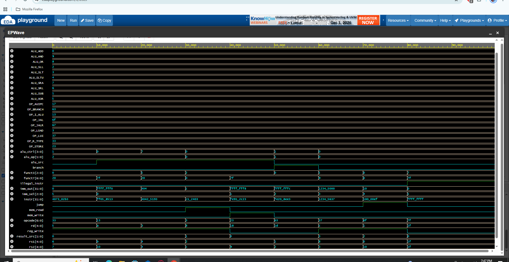

# RV32I Instruction Decoder, Immediate Generator & ALU Controller

A synthesizable SystemVerilog implementation of the **Instruction Decode (ID) stage** for a 32-bit RISC-V (`RV32I`) processor core, accompanied by a self-checking SystemVerilog testbench.

## Architecture & Features
* **Full Base ISA Coverage:** Decodes all 6 core RV32I instruction formats (`R`, `I`, `S`, `B`, `U`, and `J` types).
* **Sign-Extended Immediate Generator:** Handles bit-field unscrambling and two's-complement sign extension for 12-bit (`I`, `S`), 13-bit branch (`B`), 20-bit upper (`U`), and 21-bit jump (`J`) immediates.
* **Two-Level ALU Control:** Generates a 4-bit `alu_ctrl` signal supporting arithmetic, logical, comparison (`SLT`/`SLTU`), and shift (`SLL`/`SRL`/`SRA`) operations.
* **Datapath & Hazard Safeguards:** Outputs clean datapath control flags (`reg_write`, `alu_src`, `mem_read`, `mem_write`, `branch`, `jump`, `result_src`), flags `illegal_instr` on unsupported opcodes, and enforces default assignments to prevent unintended latch inference.

## Verification & Simulation Waveforms
Verified using a directed, self-checking SystemVerilog testbench (`tb/tb_rv32i_decoder.sv`) simulated on **Icarus Verilog 12.0** (`-g2012`).

* **Test Coverage:** Validates negative immediate sign-extension (`ADDI`, `SW`, `BEQ`), upper immediates (`LUI`), unconditional jumps (`JAL`), arithmetic right shifts (`SRAI`), and illegal opcode detection.
* **Simulation Result:** `9 PASSED, 0 FAILED`

## Repository Structure
* `rtl/rv32i_decoder_imm_gen.sv` — Synthesizable SystemVerilog RTL module.
* `tb/tb_rv32i_decoder.sv` — Self-checking testbench with automated pass/fail assertions.
* `docs/epwave_simulation.png` — EPWave timing waveform capture.

## How to Run
1. Load `rtl/rv32i_decoder_imm_gen.sv` and `tb/tb_rv32i_decoder.sv` into [EDA Playground](https://www.edaplayground.com/) (or compile locally with `iverilog -g2012`).
2. Enable `$dumpfile("dump.vcd")` to view signal transitions in EPWave / GTKWave.
